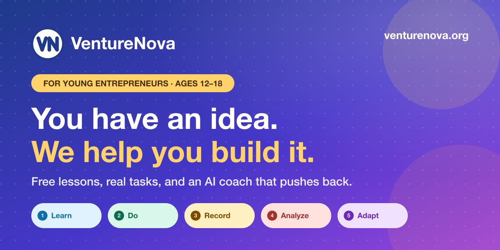
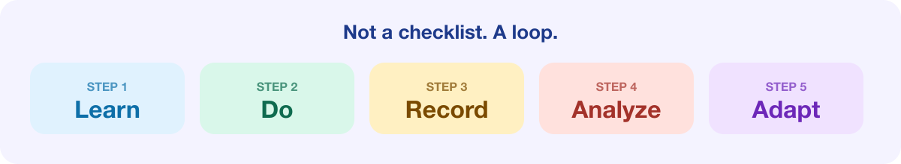

<p align="center">
  
</p>

<p align="center">
  <a href="https://venturenova.org"><b>Try it free at venturenova.org &rarr;</b></a>
</p>

<p align="center">
  
  
  
  
  
  
</p>

# VentureNova

**A free, AI-coached entrepreneurship platform for young founders ages 12–18.** Describe your idea, get a roadmap built for your kind of venture, and prove it works with real evidence, not just by clicking through lessons.

Most business-learning sites reward activity. VentureNova measures progress by evidence: did you talk to real people, test your idea, and change your plan based on what you learned?

> Built by a student as part of the Lumos Fellows Program, starting from [create-lumos-app](https://github.com/lumos-fellows/create-lumos-app).

## Try it in 60 seconds

1. Go to **[venturenova.org](https://venturenova.org)** and sign up with an email and password. There's no email verification step.
2. Describe your idea in a sentence.
3. Do your first task, then ask the AI coach to poke holes in your plan.

It works great on a phone.

## How it works

<p align="center">
  
</p>

A student describes an idea, gets a personalized roadmap, completes real tasks, records what happened, and lets the roadmap adapt to the evidence.

## Features

- **Personalized roadmaps** for different venture types (a tutoring service and an app need different next steps)
- **50 short lessons with quizzes**, plus real-world tasks
- **AI Coach** that knows the student's venture and stage, challenges weak assumptions, and won't invent customer quotes or give personal financial advice
- **A venture workspace**: Validation Lab, Interviews, Evidence Vault, Competitors, Decisions, MVP Planner, and Launch Center
- **Health score and "next best action"** based on evidence, not clicks
- **Public share page and portfolio** for showing a venture to others
- **Accounts with first-name greetings**, and a private admin view with an audit log
- **Responsive design** that works on phones, so students can use it in class

## Tech stack

| Area | Choice |
|------|--------|
| Framework | Next.js 16 (App Router), React 19, TypeScript |
| Styling | Tailwind CSS v4 with OKLCH design tokens |
| Database and auth | Supabase (Postgres with row-level security) |
| AI | Anthropic Claude API |
| Hosting | Vercel |
| Tooling | Biome (lint and format), Zod + t3-env for validated environment variables |

## Getting started

```bash
npm install
# create .env.local and fill in the values below
npm run dev
```

Open [http://localhost:3000](http://localhost:3000).

### Environment variables

All environment variables are validated in `src/env.ts`.

| Variable | Required | Description |
|----------|----------|-------------|
| `NEXT_PUBLIC_SUPABASE_URL` | Yes | Your Supabase project URL |
| `NEXT_PUBLIC_SUPABASE_ANON_KEY` | Yes | Your Supabase anon/public key |
| `ANTHROPIC_API_KEY` | No | Enables the AI Coach (the rest of the site works without it) |

Never commit `.env.local`. It is ignored by git.

### Database

Schema changes live in `supabase/migrations/` and are applied with the Supabase CLI:

```bash
npx supabase db push --dry-run   # preview
npx supabase db push             # apply
```

### Scripts

| Command | Description |
|---------|-------------|
| `npm run dev` | Start the development server |
| `npm run build` | Build for production |
| `npm run start` | Run the production build |
| `npm run lint` | Lint with Biome |
| `npm run format` | Format with Biome |
| `npm run typecheck` | Type-check with TypeScript |

## Project structure

```
src/app/          Pages and routes (landing, dashboard, ventures, admin, public share)
src/components/   UI, app shell, landing page, venture workspace components
src/lib/          Session, AI, insights, lessons, tasks, and roadmap logic
supabase/         Database migrations and config
docs/PRD.md       Product spec and MVP scope
```

## Safety and privacy

- Row-level security on every table, so students can only read and write their own data
- AI Coach has usage limits and refuses to fabricate evidence
- Admin access is restricted to listed admins, and every admin view is written to an audit log

## Status

Beta. Built and launched in October 2026, and being tested with its first real students.
